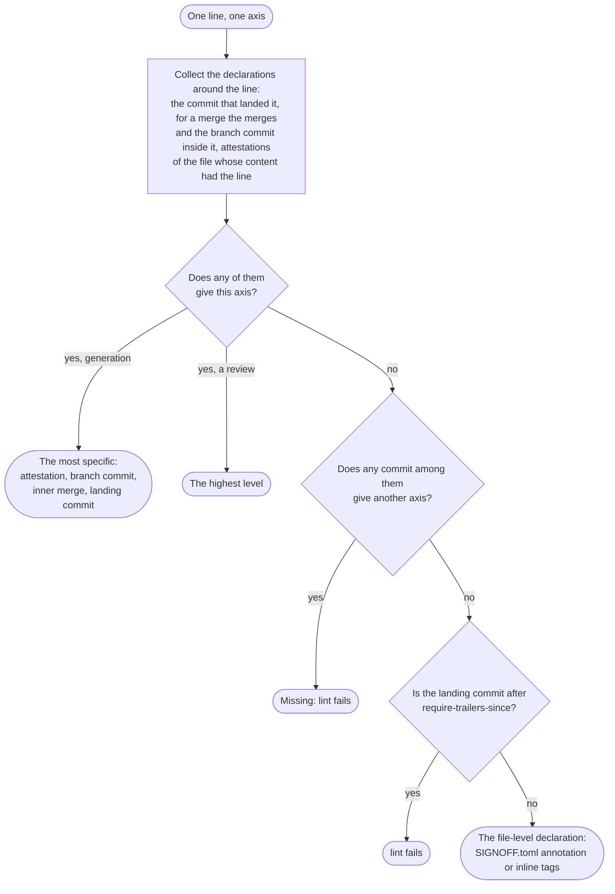

# Line by line

`SIGNOFF.toml` and inline tags declare whole files. With `[history]`, aisignoff declares **each line** instead, from git: a line takes the declaration of the commit that brought it in, so a pull request that changes 35 lines of a 800-line file changes the levels of those 35 lines, not of the whole file.

```toml
version = 3

[history]
enabled = true
```

Nothing else has to change. Lines without a declaration from git keep the file-level declaration, so a repository whose commits carry no trailers yet reports exactly what it did before; lines become more precise as declared commits land.

## Where a line's levels come from

Several declarations can describe one line:

- **The commit that landed it** on the current branch, which `git blame --first-parent` finds: a commit made on the branch directly, a squash commit, or the merge commit of a pull request. Its message carries the levels as ["Key: value" lines](#declaring-commits) or as the ticked checkboxes of a [pull request template](#pull-request-checkboxes), and a `[[commits]]` entry corrects them.
- For a merge commit, **the commits inside it**: the commit of the merged branch that wrote the line, and the merge commits it came through on the way, such as a pull request merged into another pull request.
- **An attestation** of the file whose checked content had the line: "this whole file was reviewed, as it was then". See [Re-declaring a whole file](#re-declaring-a-whole-file).

The axes combine them differently:

| Axis | The line takes | Why |
|---|---|---|
| **Generation** | The most specific declaration: an attestation that gives it, else the commit that wrote the line, else the merges it came through (the innermost first), else the commit that landed it | How a line was written is known best by whoever wrote it: a hand-written G0 commit stays G0 inside an AI-written pull request |
| **Human review**, **AI review** | The **highest** level among all of them. On a tie, the names of the later one | Each of them saw the line as it is now, and a later review of the whole pull request doesn't undo a closer review of a commit (nor the other way round) |

A `TODO` inside a pull request yields to any level, but a `TODO` of the pull request itself (or of the commit that landed the line) wins over the levels inside it: "a person still has to review this" stays until it's filled in, by a `[[commits]]` entry for that commit or by an attestation of the file (the review it asked for).

**A1 doesn't reach hand-written lines.** A1 means the session that generated the change checked its own work, so it only describes lines that session wrote. A line whose generation is G0, such as a hand-written commit inside a pull request ticked A1, takes the next AI review down: A2 or A3 if anything around it declares one, else A0. A declaration that gives G0 and A1 itself is invalid, as in `SIGNOFF.toml`.

**Raised reviews are reported.** No declaration lowers a review, so a commit inside a pull request that declares a higher review than the pull request (often an agent claiming a review before anyone did it) sets the level of its lines. `lint` names each such commit with the `[[commits]]` entry that would settle it, and `lint --strict` fails on them. The same goes for a review that only a commit inside declares, when the pull request declares levels but leaves that axis out. A level that is too high is corrected with a [`[[commits]]` entry](#correcting-a-commit) for the commit that declared it; corrections themselves are never reported.

When none of the commits declares anything for a line, it takes **the file-level declaration**: the matching annotation in `SIGNOFF.toml`, or the file's inline tags. That is the baseline for lines from before declared commits. But once a commit around the line declares some axis, an axis that all of them leave out is **missing**, and `lint` reports it: a commit that declares only `AI-Generation: G3` doesn't get the review of the old code from the file. Attestations don't count for this rule: `attest -H` on old, undeclared code raises its review, and generation and AI review stay at the file level.

As a flow, for one line and one axis:



So the layers, from the bottom:

| Layer | Set by | Covers |
|---|---|---|
| File-level declaration | `[[annotations]]` in `SIGNOFF.toml`, inline tags | Lines that nothing above declares anything for: the baseline |
| Commit declarations | "Key: value" lines or checkboxes of the commit that landed the line, of the merges and the branch commit inside it, corrected by `[[commits]]` | The lines those commits added or changed |
| Attestation | `aisignoff attest` (`[[attestations]]`) | Every line of the file as it was when attested, until the line changes again |

For example, a pull request with three commits, merged with a merge commit, while `main` moved on with a direct commit:


| Lines from | Get | Because |
|---|---|---|
| `before` | the file-level declaration | nothing around them declares anything |
| `by hand: G0 H2` | G0 H2 A2 | generation from the commit; human review H2 is higher than the pull request's H1; AI review only from the pull request |
| `agent: G3 H0 A1` | G3 H1 A2 | the pull request's later reviews are higher than the commit's |
| `no declaration` | G3 H1 A2 | everything from the pull request |
| `direct: G3 H1 A1` | G3 H1 A1 | its own declaration; it isn't part of the pull request |

The axes stay separate. Generation follows the line: it only changes when the line changes. A review (human or AI) can be raised for a whole file by an attestation, without touching generation.

For example, a 200-line `solver.py`:

| Step | Result |
|---|---|
| A pull request adds the file, declared G0 H2 A0 | 200 lines G0 H2 A0 |
| Another one rewrites 100 lines, declared G2 H1 A1 | 100 lines G0 H2 A0, 100 lines G2 H1 A1 |
| `aisignoff attest solver.py -H H2 --reviewed-by "Jane Doe"` | 100 lines G0 H2 A0, 100 lines G2 **H2** A1 |
| A third one changes 10 lines, declared G2 H1 A1 | those 10 lines are back to H1, the other 190 stay H2 |

## Declaring commits

A commit declares its lines with "Key: value" lines in its message, using the same keys as `SIGNOFF.toml`:

```
Add the folder report

AI-Generation: G3
Human-Review: H1
AI-Review: A1
Assisted-by: Claude Opus 5.5 (Anthropic)
Reviewed-by: Jane Doe
AI-Reviewed-by: Claude Opus 5.5 (Anthropic), self-check by the generating session
```

- **Anywhere in the message body**, at the start of a line, not only in git's trailer paragraph at the end: a `Co-authored-by:` paragraph after them, or the co-author block GitHub appends to squash commits, doesn't hide them. Lines in fenced code blocks and HTML comments don't count, so a message can quote an example. A block or comment that is never closed isn't one (the blocks before it still are), inline code at the start of a line (```` ```like this``` ````) opens no block, and `` `<!--` `` in inline code opens no comment, so none of them hides what follows. The subject line doesn't count either.
- **An axis counts when its level is there.** A name on its own, such as the common `Reviewed-by:` trailer without `Human-Review:`, declares nothing.
- **Declare what you know.** A commit made by an AI agent knows its generation and its own self-check (`AI-Generation`, `AI-Review`), but not the human review that comes later: leave `Human-Review` to the pull request. Because reviews take the highest level, a review claimed too early would stick (`lint` reports it, and `[[commits]]` corrects it). In a repository that lands pull requests by rebase, there is no pull request declaration: every commit declares all three axes.
- **Pull requests:** set *Settings → General → Pull Requests* → the default commit message of merge commits (and of squash commits, if you allow them) to **Pull request title and description**, and put the lines in the pull request description. The declaration then lands in git with the code. GitHub's default message for merge commits holds only the title, so without this setting the declaration never reaches git.
- **TODO** works as in `SIGNOFF.toml`: `lint` reports it until it's filled in, by the commit itself through `[[commits]]`, or by any declaration around the line that gives a level (such as the pull request's).

### Pull request checkboxes

A pull request template can declare the levels with checkboxes instead, as the template of the Industrial Mathematics Group does. With the commit message *Pull request title and description*, the ticked boxes land in the commit message, and aisignoff reads them like "Key: value" lines.

```markdown
- [x] **G3** AI-autonomous: an agent produced it largely end to end
- [x] **Claude Opus** (Anthropic)
- [ ] **Other:** 
- [x] **H0** I checked the result as a whole
- [x] **H1** I ran the tests or reproduced the key results myself
- [ ] **A0** No AI review
- [x] **A1** The AI that wrote the change checked its own work
- [ ] **A2** A new AI session ... reviewed the final change. Model, if not one of the above: 
```

| Axis | Level | Names |
|---|---|---|
| Generation | the ticked `**G…**` box (more than one is a problem) | the ticked models (`**Name** (Vendor)`) between the generation and the human review boxes, and the text after `**Other:**` |
| Human review | the highest ticked `**H…**` box | the commit author: on GitHub the pull request's author for a squash commit, but whoever clicked *Merge* for a merge commit (correct it with `[[commits]]` if that wasn't the reviewer) |
| AI review | the highest ticked `**A…**` box; **A0** when the AI review boxes are there but none is ticked (or the A0 box is) | the text after `Model:` in that box, or else the models that wrote the change |

Boxes in fenced code blocks and HTML comments don't count, and other bold checklist items (`- [x] **Breaking change**`) aren't models.

A commit declares itself one way or the other. One with both "Key: value" lines and ticked level boxes is reported by `lint`; until a `[[commits]]` entry for that commit settles it (any entry counts as settled, so check the axes where the two disagree), both count, the lines winning where they overlap.

So each pull request declares its own lines, and `SIGNOFF.toml` doesn't grow with every pull request: it keeps the defaults for lines without a declaration, `[[commits]]` corrections and attestations.

### Merge, squash or rebase

`git blame --first-parent` follows only the first parents of the default branch, so every line a pull request brought in belongs to the commit that landed it there, and lines that were on the branch before the pull request started never do. How a pull request lands decides what declares its lines:

| Pull request lands as | Its lines are declared by |
|---|---|
| **Merge commit** (recommended) | The merge commit (the pull request description) and, for the lines it wrote, the commit of the branch, with its "Key: value" lines or checkboxes: generation from the branch commit if it gives one, reviews from the higher of the two. A pull request merged into another one counts too, as a merge inside it |
| **Squash** | The squash commit alone (the pull request description). The commits of the branch are gone, and so are their own declarations |
| **Rebase** | Each commit on its own: they land on the default branch one by one, without the pull request description. A commit without a declaration falls back to `SIGNOFF.toml` (or fails `require-trailers-since`) |
| **Commit on the default branch** | That commit |

Commits that merge the default branch into the pull request's branch, and conflict resolutions, declare nothing themselves, so their lines take the pull request's declaration. A `git pull` that creates a merge commit on the default branch works the same way: the pull requests it brings in are merges inside it. (`pull.rebase` avoids that merge commit.)

A commit only needs to declare what is known when it's written. For example, a hand-written commit declares

```
AI-Generation: G0
Human-Review: H2
Reviewed-by: Jane Doe
```

and nothing on AI review. If the pull request is then reviewed as a whole by a fresh AI session and declares A2 (and G3 H1 for the rest), the lines of that commit end up G0 H2 A2, and the other lines of the pull request G3 H1 A2.

**The pull request's CI run** checks out a merge preview of it. Tell aisignoff how pull requests land, so `lint` and `aisignoff diff` show what will land:

```toml
[history]
enabled = true
merge-method = "merge"   # the default; or "squash", or "rebase"
```

The same applies to `aisignoff diff BASE -g/-H/-a` on the branch itself: the commits after the base are resolved as the merge will resolve them, with the declaration standing for the pull request. That includes a branch that merged the base meanwhile (GitHub's *Update branch*); lines of the base it brought in keep the base's declarations.

Without `--declare`, as in `lint` on the merge preview, the pull request description isn't known yet: axes that the branch's commits leave out show the file-level declaration until it lands. `signoff-pr-diff.yml` passes the description, so its table shows what will land.

With `squash`, the branch's commits are ignored (the squash commit won't have them) and only the declaration passed with `aisignoff diff -g/-H/-a` (the pull request description) counts. With `rebase`, that declaration is ignored and only the branch's commits count; since they land as they are, the preview isn't exempt from `require-trailers-since` or from the missing-axis check.

**Reverts** take over the lines they restore: a `git revert` commit, or GitHub's *Revert* pull request, is the commit that landed them, and its message usually declares nothing, so the lines fall back to the file-level declaration (or fail `require-trailers-since`). Declare the revert with the levels of what it restores, in its message or with a `[[commits]]` entry.

### Correcting a commit

The history of the default branch isn't rewritten, so a missing or wrong trailer is corrected in `SIGNOFF.toml`, per axis:

```toml
[[commits]]
commit = "6686c01"           # at least 4 hex digits
Human-Review = "H2"          # reviewed after the merge
Reviewed-by = "Jane Doe"
```

The same works for old commits without a declaration ("backfilling"). An entry for a commit that isn't in the history of `HEAD`, such as a commit from before a rebase or a branch commit of a squashed pull request, declares nothing, and `lint` says so.

## Re-declaring a whole file

After reviewing a whole file, attest it:

```bash
aisignoff attest src/solver.py -H H2 --reviewed-by "Jane Doe"
aisignoff attest src/ -a A2 --ai-reviewed-by "GPT-5 (OpenAI), fresh session"   # every file below src/
```

This appends one entry per file to `SIGNOFF.toml`, with the git blob hash of the content you checked:

```toml
[[attestations]]
path = "src/solver.py"
blob = "3f1c9e0d5b6a7c8e9f0a1b2c3d4e5f6a7b8c9d0e"
Human-Review = "H2"
Reviewed-by = "Jane Doe"
```

- **It covers the lines that content had.** Lines changed afterwards fall back to the declaration of their own commit. So an attestation never covers code written after the review, and can stay in the file.
- **Content, not commits.** The blob survives a squash merge, unlike a commit hash, and a rename: the attestation follows the file to its new name (`git mv`, detected by git). Commit the attestation in the same pull request as the review, or later.
- **A path that was renamed away and created again** is reported: say which file was checked by setting its current path.
- **That file only.** The same content in another file, such as a copy, doesn't extend the attestation.
- **Concurrent changes.** If `main` changes the file while the pull request with the attestation is open, the merged file is new content. The attestation still covers the lines the checked content had: those whose commit was part of it.
- **It checks itself.** If the file changes again before the attested content reaches the branch, `lint` reports that the attestation points at content that never landed: attest again.
- **`--at REV`** attests the files as they were at an earlier commit, e.g. the commit a committed review covered.
- **Generation** can be attested too (`-g`), for corrections; normally an attestation only raises the review axes.

## Requiring declared commits

```toml
[history]
enabled = true
require-trailers-since = "a1b2c3d"
```

Lines of commits after `a1b2c3d` must be declared ("Key: value" lines, checkboxes, `[[commits]]` or an attestation); `lint` fails instead of falling back to the file-level declaration. This catches a forgotten pull request template or squash setting. The merge preview that a pull request's CI run checks out (a merge commit at `HEAD` with GitHub's subject `Merge <sha> into <sha>`) is exempt, since the pull request isn't merged yet, unless it lands by rebase (`merge-method = "rebase"`). On a `push` event (`GITHUB_EVENT_NAME=push`) no commit is taken for a preview.

This check needs the whole history: in a shallow clone or outside git, `lint` fails, rather than passing without it.

## Showing a change: `aisignoff diff`

```bash
aisignoff diff origin/main
```

```
Changes since origin/main (6686c01): +412 −38 lines in 9 file(s)

       +lines  -lines  Generation (added)  Human review (added)  AI review (added)
docs/     +95     -12  G3 +95              H1 +95                A1 +95
src/     +317     -26  G3 +317             H1 +317               A1 +317

Attested:
  src/aisignoff/model.py  H2

Whole repository, by lines:
  Human review: H1 69.0% → 66.6% (-2.4) · H2 31.0% → 33.4% (+2.4)
```

Like a coverage diff, it shows only what changed: the levels of the added lines (now), of the removed lines (at the base, in `--json`), the attestations the change adds, and how the shares of the whole repository move. It compares the working tree, so it also works before committing. The base is the merge base of `BASE` and `HEAD`, as in a pull request on GitHub: when `main` has moved on since a branch started, its new commits aren't part of the branch's change.

| Option | Effect |
|---|---|
| `--depth N` | Group by folders down to depth `N` (default 1) |
| `--files` | One row per file |
| `--markdown` | A Markdown table, e.g. for the job summary of a pull request |
| `--json` | Everything, including the levels of the removed lines |
| `-g`, `-H`, `-a` and the name options | Declare the change: lines after the base without a declaration of their own take these levels (not in files with `precedence = "override"`) |

For the same change in the [folder report](report.md), with each changed line in its file: `aisignoff report --html report.html --with-source --since origin/main`.

The last row is for pull requests: before the merge, their lines have no squash commit yet, so a workflow can pass the levels from the pull request description. [`signoff-pr-diff.yml`](integration.md) does that.

## Where history isn't available

- **Outside a git repository** and in **shallow clones** (the default of `actions/checkout`), aisignoff warns and uses the file-level declarations; with `require-trailers-since`, `lint` fails. In CI, check out with `fetch-depth: 0`.
- **Binary and empty files and symlinks** are one unit, counted as one line: the whole file takes the declaration of the commit that last changed it.
- **`precedence = "override"`** on an annotation keeps its files file level, e.g. for vendored or generated code.
- **Reformatting commits** would take over every line they touch. List them in `.git-blame-ignore-revs` (used automatically, or set `ignore-revs-file` in `[history]`). An entry that isn't a commit of the repository is reported by `lint`.
- **Whitespace-only changes** are ignored (`git blame -w`), so a line keeps its declaration when it's only reindented. In Python, indentation can change what code does: when an AI wraps hand-written code in a new block, those lines stay G0. Set `ignore-whitespace = false` in `[history]` to give reindented lines to the commit that reindented them.
