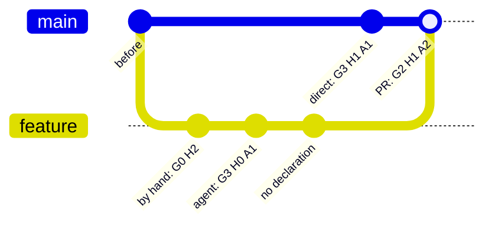

# Line by line

`SIGNOFF.toml` and inline tags declare whole files. With `[history]`, aisignoff declares **each line** instead, from git: a line takes the declaration of the commit that brought it in, so a pull request that changes 35 lines of a 800-line file changes the levels of those 35 lines, not of the whole file.

```toml
version = 3

[history]
enabled = true
```

Nothing else has to change. Lines without a declaration from git keep the file-level declaration, so a repository whose commits carry no trailers yet reports exactly what it did before; lines become more precise as declared commits land.

In short: a pull request into the default branch declares its lines with its description, a commit pushed there directly declares its own (or leaves them to the file-level declaration), and [`aisignoff freeze`](#freezing-the-levels-aisignoff-freeze) records the result so that it stays.

## Where a line's levels come from

Every line has **one owner**, and the owner declares it. Five rules decide the levels of a line:

1. **Frozen.** A line that hasn't changed since the [snapshot](#freezing-the-levels-aisignoff-freeze) has the levels the snapshot recorded.
2. **Owner.** Otherwise the owner is the commit that landed the line on the default branch, which `git blame --first-parent` finds: a commit made there directly, a squash commit, or the merge commit of a pull request. Its message carries the levels as ["Key: value" lines](#declaring-commits) or as the ticked checkboxes of a [pull request template](#pull-request-checkboxes), and a [`[[commits]]` entry](#correcting-a-commit) corrects them. Commits and pull requests *inside* it declare nothing.
3. **Generation of a commit inside.** One exception, for generation only: inside a merge commit that declares its lines, the commit that wrote a line can say a *higher* `AI-Generation` for it, such as an agent's G3 commit in a pull request declared G1. Its message can't lower the generation: G0 is the one claim that takes the AI review requirement off a line, so it isn't left to a commit that nobody reviewed as a declaration. A [`[[commits]]` entry](#correcting-a-commit) for that commit can say it, such as for a hand-written commit in an AI-written pull request.
4. **Reviews.** A review is the higher of the owner's level and an [attestation](#re-declaring-a-whole-file) of the file whose checked content had the line. On a tie, the names of the attestation. An attestation never says generation.
5. **Nothing declared.** An owner that declares nothing leaves its lines to **the file-level declaration**: the matching annotation in `SIGNOFF.toml`, or the file's inline tags. With [`undeclared = "error"`](#requiring-declared-commits), `lint` fails instead. An owner that declares some axes but leaves one out, or whose template isn't filled in, is always an error.

So a pull request into the default branch declares its lines, once, with the description that lands as the message of its merge or squash commit. A review claimed by a commit inside it, or by a pull request that was merged into it, doesn't count: after the merge, raise a review with an attestation, or correct the owner with a `[[commits]]` entry.

Why one owner? The lines that `git blame --first-parent` gives to a commit of the default branch are exactly the diff that its pull request showed to the reviewer, whether it landed as a merge commit or a squash commit, and in whatever order stacked pull requests were merged. The description of that pull request is the one statement that was made about exactly those lines.

As a flow, for one line and one axis:


Some details:

- **`TODO`** is below every level. A `TODO` review of the owner stays until a `[[commits]]` entry for it or an attestation of the file (the review it asked for) fills it in. A template that isn't filled in counts the same way: generation or human review boxes with none ticked, or a `Human-Review:` line left empty, are `TODO`, not "nothing declared".
- **A1 doesn't reach hand-written lines.** A1 means the session that generated the change checked its own work, so it only describes lines that session wrote. A line that a `[[commits]]` entry declares G0, while the pull request ticks A1, takes A0, or the A2 or A3 of an attestation. A declaration that gives G0 and A1 itself is invalid, as in `SIGNOFF.toml`.
- **Attestations and the file-level declaration.** An attestation counts on its own: `attest -H` on old, undeclared code raises its human review, and generation and AI review stay at the file level.

For example, a pull request with three commits, merged with a merge commit, while `main` moved on with a direct commit:



| Lines from | Get | Because |
|---|---|---|
| `before` | the file-level declaration | their owner declares nothing |
| `by hand: G0 H2` | G2 H1 A2 | everything from the pull request: a commit's message can't lower the generation (a `[[commits]]` entry for it can) |
| `agent: G3 H0 A1` | G3 H1 A2 | the higher generation of the commit that wrote them; the reviews are the pull request's |
| `no declaration` | G2 H1 A2 | everything from the pull request |
| `direct: G3 H1 A1` | G3 H1 A1 | its own declaration; it landed on `main` itself |

The axes stay separate. Generation follows the line: it only changes when the line changes. A review (human or AI) can be raised for a whole file by an attestation, without touching generation.

For example, a 200-line `solver.py`:

| Step | Result |
|---|---|
| A pull request adds the file, declared G0 H2 A0 | 200 lines G0 H2 A0 |
| Another one rewrites 100 lines, declared G2 H1 A1 | 100 lines G0 H2 A0, 100 lines G2 H1 A1 |
| `aisignoff attest solver.py -H H2 --reviewed-by "Jane Doe"` | 100 lines G0 H2 A0, 100 lines G2 **H2** A1 |
| A third one changes 10 lines, declared G2 H1 A1 | those 10 lines are back to H1, the other 190 stay H2 |

## Lines that haven't landed yet

On a feature branch, in the merge preview that a pull request's CI run checks out, or with uncommitted changes, some lines aren't on the default branch. They are the diff against it: against the newest commit of the default branch that `HEAD` contains, as in a pull request on GitHub. Everything else resolves as on the default branch, whatever the branch merged in the meantime.

- **Without a declaration for the change,** these lines show the generation their own commits say, or the file-level declaration, and nothing about them fails `lint`: a commit by an agent that leaves the human review to the pull request is fine on its branch. A review that such a commit claims isn't shown, in `lint`, `report` or `diff`: the pull request will declare the reviews, so they count as undeclared until then. (With `merge-method = "rebase"` the commits land as they are, and their reviews are shown.) `lint` and `report` say how many such lines aren't fully declared yet.
- **With one,** they resolve as they will land. `aisignoff lint --declare-from description.md`, `aisignoff report --declare-from description.md` and `aisignoff diff BASE --declare-from description.md` read the pull request description exactly as the merge or squash commit's message will be read, and the description then has to be complete: this is the check that a pull request into the default branch declares its lines. `diff` also takes the levels as options (`-g`, `-H`, `-a` and the names).
- **A pull request into another branch** than the default one, such as the upper one of two stacked pull requests, declares nothing: its lines are declared by the pull request that later lands them on the default branch. `lint --base` and `diff BASE` recognise it and say so.

aisignoff finds the default branch as `origin`'s default branch, else `main` or `master`. Set it if yours has another name:

```toml
[history]
enabled = true
default-branch = "develop"
```

When that branch is checked out, all of `HEAD` counts as landed. Otherwise `origin/<name>` is used, or the local branch if it's ahead of it. CI needs the branch to be there: check out with `fetch-depth: 0`.

**`--landed`** says that `HEAD` is a commit of the default branch, or lands on it exactly as it is. `lint`, `report` and `badge` then check and show every commit as on the default branch:

- **A merge queue** checks out the merge or squash commit that will be fast-forwarded onto the default branch, with its final message. In a GitHub Actions run of a merge queue (`merge_group`), aisignoff recognises the queue's ref and does this by itself; `lint` says so. This is the last check before the commit lands, and unlike a pull request's run it needs no description.
- **Release and maintenance branches** aren't the default branch, so their commits never count as landed, and nothing about them fails. Run `aisignoff lint --landed` (and `report --landed` for a release's report) on such a branch to hold it to the same rules.

## Declaring commits

A commit declares its lines with "Key: value" lines in its message, using the same keys as `SIGNOFF.toml`:

```
Add the folder report

AI-Generation: G3
Human-Review: H1
AI-Review: A1
Assisted-by: Claude Opus 5.5 (Anthropic)
Reviewed-by: Jane Doe
AI-Reviewed-by: Claude Opus 5.5 (Anthropic), self-check by the generating session
```

- **Anywhere in the message body**, at the start of a line, not only in git's trailer paragraph at the end: a `Co-authored-by:` paragraph after them, or the co-author block GitHub appends to squash commits, doesn't hide them. Lines in fenced code blocks and HTML comments don't count, so a message can quote an example. A block or comment that is never closed isn't one (the blocks before it still are), inline code at the start of a line (```` ```like this``` ````) opens no block, and `` `<!--` `` in inline code opens no comment, so none of them hides what follows. The subject line doesn't count either.
- **An axis counts when its level is there.** A name on its own, such as the common `Reviewed-by:` trailer without `Human-Review:`, declares nothing.
- **Inside a pull request, only `AI-Generation` counts.** The pull request's description declares its lines, so a commit on its branch needs no declaration at all. It can say `AI-Generation` where it differs from the rest, such as a hand-written commit in an AI-written pull request; its review lines are ignored. A commit that lands on the default branch itself (a direct push, or a commit of a pull request that lands by rebase) declares all three axes.
- **Pull requests:** set *Settings → General → Pull Requests* → the default commit message of merge commits (and of squash commits, if you allow them) to **Pull request title and description**, and put the lines in the pull request description. The declaration then lands in git with the code. GitHub's default message for merge commits holds only the title, so without this setting the declaration never reaches git.
- **TODO** works as in `SIGNOFF.toml`: `lint` reports it until it's filled in, by a `[[commits]]` entry for that commit or by an attestation of the file. A level line left empty (`Human-Review:`) is a `TODO` too.

### Pull request checkboxes

A pull request template can declare the levels with checkboxes instead, as the template of the Industrial Mathematics Group does. With the commit message *Pull request title and description*, the ticked boxes land in the commit message, and aisignoff reads them like "Key: value" lines.

```markdown
- [x] **G3** AI-autonomous: an agent produced it largely end to end
- [x] **Claude Opus** (Anthropic)
- [ ] **Other:** 
- [x] **H0** I checked the result as a whole
- [x] **H1** I ran the tests or reproduced the key results myself
- [ ] **A0** No AI review
- [x] **A1** The AI that wrote the change checked its own work
- [ ] **A2** A new AI session ... reviewed the final change. Model, if not one of the above: 
```

| Axis | Level | Names |
|---|---|---|
| Generation | the ticked `**G…**` box (more than one is a problem) | the ticked models (`**Name** (Vendor)`) between the generation and the human review boxes, and the text after `**Other:**` |
| Human review | the highest ticked `**H…**` box | the commit author: on GitHub the pull request's author for a squash commit, but whoever clicked *Merge* for a merge commit (correct it with `[[commits]]` if that wasn't the reviewer) |
| AI review | the highest ticked `**A…**` box; **A0** when the AI review boxes are there but none is ticked (or the A0 box is) | the text after `Model:` in that box, or else the models that wrote the change |

Boxes in fenced code blocks and HTML comments don't count, and other bold checklist items (`- [x] **Breaking change**`) aren't models. Generation or human review boxes that are there with none ticked are a template that wasn't filled in: `TODO`, which `lint` reports.

A commit declares itself one way or the other. One with both "Key: value" lines and ticked level boxes is reported by `lint`; until a `[[commits]]` entry for that commit settles it (any entry counts as settled, so check the axes where the two disagree), both count, the lines winning where they overlap.

So each pull request declares its own lines, and `SIGNOFF.toml` doesn't grow with every pull request: it keeps the defaults for lines without a declaration, `[[commits]]` corrections and attestations.

### Merge, squash or rebase

How a pull request lands decides which commit owns its lines:

| Pull request lands as | Its lines are declared by |
|---|---|
| **Merge commit** | The merge commit: the pull request description. A commit of the branch can say `AI-Generation` for the lines it wrote |
| **Squash** | The squash commit: the pull request description. The commits of the branch are gone |
| **Rebase** | Each commit on its own: they land on the default branch one by one, without the pull request description. A commit without a declaration falls back to `SIGNOFF.toml` (or fails with `undeclared = "error"`) |
| **Commit on the default branch** | That commit |

Merge and squash give the same reviews. They differ only where a commit of the branch says another generation than the pull request.

**Stacked pull requests.** When B is merged into A and A into the default branch, A's merge or squash commit owns all the lines, B's included: A's description has to cover them, and B's description is never read. When B is retargeted and lands on the default branch itself, it owns the lines its merge brings in. Either way a line's levels are what the pull request into the default branch declared for the diff it showed.

**`git pull` on the default branch.** A `git pull` that creates a merge commit on the default branch owns everything it brought in, including pull requests that had landed on the remote, and declares nothing. `lint` warns about a merge that declares nothing while commits inside it do: merge commits with a declaration, or other commits that declare all three axes, such as squash-merged pull requests. Avoid it with `pull.rebase`, or declare the merge commit with a `[[commits]]` entry.

**A pull request that declares nothing.** With the default `undeclared = "baseline"`, a merge or squash commit whose message has no declaration at all quietly leaves its lines to the file-level declaration (an unfilled template is an error, see above). `lint` warns about undeclared commits that look like pull requests, by a subject like "Merge pull request #12 …" or one ending in "(#12)", in one line for all of them. Declare them with `[[commits]]` entries, or accept the levels as they are with a snapshot.

**Reverts** take over the lines they restore: a `git revert` commit, or GitHub's *Revert* pull request, is the commit that landed them, and its message usually declares nothing, so the lines fall back to the file-level declaration. `lint` warns about a revert that declares nothing (`lint --strict` fails): a commit whose message says "This reverts commit …" or "Reverts owner/repo#12", whose subject starts with `Revert "`, or a merge commit with such a commit inside. Declare the revert with the levels of what it restores, in its message or with a `[[commits]]` entry. Only a file whose whole content is the [snapshot's](#freezing-the-levels-aisignoff-freeze) again gets its old levels back by itself.

**Moved lines** belong to the commit that moved them: a line that moves to another file is a new line there.

**The pull request's CI run** checks out a merge preview of it. Tell aisignoff how pull requests land, so that `lint --declare-from` and `aisignoff diff` show what will land:

```toml
[history]
enabled = true
merge-method = "merge"   # the default; or "squash", or "rebase"
```

With `squash`, what the branch's commits say about generation is ignored, since the squash commit won't have them. With `rebase`, the description is ignored and each commit declares its own lines; since they land as they are, the merge preview of such a pull request is checked like the default branch, without a description.

### Correcting a commit

The history of the default branch isn't rewritten, so a missing or wrong trailer is corrected in `SIGNOFF.toml`, per axis:

```toml
[[commits]]
commit = "6686c01"           # at least 4 hex digits
Human-Review = "H2"          # reviewed after the merge
Reviewed-by = "Jane Doe"
```

The same works for old commits without a declaration ("backfilling"). An entry corrects the commit that owns the lines: for a pull request, its merge or squash commit. For a commit inside a merged pull request, only `AI-Generation` counts (also a lower one than the pull request's, which the commit's own message can't say), and `lint` warns about review levels there. An entry for a commit that isn't in the history of `HEAD`, such as a commit from before a rebase or a branch commit of a squashed pull request, declares nothing, and `lint` says so. Entries don't change lines that a [snapshot](#freezing-the-levels-aisignoff-freeze) has frozen.

## Re-declaring a whole file

After reviewing a whole file, attest it:

```bash
aisignoff attest src/solver.py -H H2 --reviewed-by "Jane Doe"
aisignoff attest src/ -a A2 --ai-reviewed-by "GPT-5 (OpenAI), fresh session"   # every file below src/
```

This appends one entry per file to `SIGNOFF.toml`, with the git blob hash of the content you checked:

```toml
[[attestations]]
path = "src/solver.py"
blob = "3f1c9e0d5b6a7c8e9f0a1b2c3d4e5f6a7b8c9d0e"
Human-Review = "H2"
Reviewed-by = "Jane Doe"
```

- **It covers the lines that content had.** Lines changed afterwards fall back to the declaration of their own commit. So an attestation never covers code written after the review, and can stay in the file.
- **Content, not commits.** The blob survives a squash merge, unlike a commit hash, and a rename: the attestation follows the file to its new name (`git mv`, detected by git). Commit the attestation in the same pull request as the review, or later.
- **A path that was renamed away and created again** is reported: say which file was checked by setting its current path.
- **That file only.** The same content in another file, such as a copy, doesn't extend the attestation.
- **Concurrent changes.** If `main` changes the file while the pull request with the attestation is open, the merged file is new content. The attestation still covers the lines the checked content had: those whose commit was part of it.
- **It checks itself.** If the file changes again before the attested content reaches the branch, `lint` reports that the attestation points at content that never landed: attest again.
- **`--at REV`** attests the files as they were at an earlier commit, e.g. the commit a committed review covered. That also works for content from before a [snapshot](#freezing-the-levels-aisignoff-freeze): the attestation covers the frozen lines that the checked content already had, by comparing it with the file as of the snapshot.
- **Not for files declared as a whole.** A file under an annotation with `precedence = "override"` is never resolved line by line, so `attest` refuses it: change the annotation instead.
- **Reviews only.** An attestation says `Human-Review` or `AI-Review`. The generation of a line is declared by the commit that landed it, and corrected with a [`[[commits]]` entry](#correcting-a-commit). An `AI-Generation` in an entry written by an earlier version doesn't count, and `lint` warns about it.

## Requiring declared commits

```toml
[history]
enabled = true
undeclared = "error"
```

By default, a commit that declares nothing leaves its lines to the file-level declaration, so a quick push stays quick. With `undeclared = "error"`, every commit that lands lines on the default branch must declare them ("Key: value" lines, checkboxes, `[[commits]]` or an attestation), and `lint` fails otherwise. This catches a forgotten pull request template or squash setting. Set it together with a [snapshot](#freezing-the-levels-aisignoff-freeze), which keeps older, undeclared commits out of it. `require-trailers-since = "a1b2c3d"` does the same for the commits after one commit only.

Lines that [haven't landed yet](#lines-that-havent-landed-yet) are exempt, unless the pull request lands by rebase (`merge-method = "rebase"`).

This check needs the whole history: in a shallow clone or outside git, `lint` fails, rather than passing without it.

## Freezing the levels: `aisignoff freeze`

Without a snapshot, aisignoff works out every line's levels from the whole history on each run. A new version that reads a message differently, or a changed annotation, would then change the levels of code that was merged long ago. A snapshot stops that:

```bash
git switch --detach origin/main     # a commit of the default branch, nothing else changed
aisignoff freeze
git switch -c freeze && git add SIGNOFF.snapshot.json && git commit -m "Freeze the declarations"
```

`aisignoff freeze` writes `SIGNOFF.snapshot.json`: the levels of every line as of that commit. From then on:

- **A line that doesn't change keeps the levels in the snapshot,** whatever a later version of aisignoff, a changed annotation or a new `[[commits]]` entry would say about it. It follows its file through a rename (a binary file as long as its content is the same). A file whose content is again exactly what the snapshot recorded, such as after a revert, has the snapshot's levels.
- **That includes the file-level declaration.** Lines that took their levels from an annotation or from inline tags keep those levels too. Editing the annotation or the tags afterwards changes nothing for the frozen lines (the tag lines themselves are new lines): raise a file with [`aisignoff attest`](#re-declaring-a-whole-file), or take a new snapshot after changing them at the snapshot's commit.
- **Lines that change afterwards** are declared by the commits that land them, as described above. History is only read from the snapshot's commit on, which also makes `lint` faster.
- **A frozen line only changes through an attestation,** which raises its reviews. Its generation stays: nothing reads the history behind it again. To correct a wrong generation, remove the file's entry from the snapshot by hand, which is a visible change to review. The file is then resolved from history, where a `[[commits]]` entry applies, until the next snapshot.
- **Files the snapshot doesn't have,** because they were excluded or declared as a whole (`precedence = "override"`) when it was taken, are resolved from the whole history once they are included.
- **Take a new snapshot when you like,** for example at each release. It replaces the old one and adds the lines that landed since. `lint` checks that it leaves the lines of the snapshot before it as they were: the same generation, and reviews that are only raised, by an attestation.
- **`aisignoff freeze --prune` starts `SIGNOFF.toml` afresh.** Every `[[commits]]` and `[[attestations]]` entry that is in `SIGNOFF.toml` when a snapshot is taken has its effect recorded in the snapshot. `--prune` moves these entries into an `archive` list in `SIGNOFF.snapshot.json`, one item per freeze, and takes them out of `SIGNOFF.toml` (with the comment lines directly above them). Nothing reads the archive to work out levels; it is the record of where they came from. Commit both files together. After that the snapshot is the only place that has these levels: they can't be worked out from the history again, so keep the file under review like `SIGNOFF.toml`.

The snapshot is taken of a commit of the default branch, with a clean working tree, and only when `lint` passes there without warnings: it would keep an error, or the levels a warning is about, for good. `freeze` prints what stands in the way; `--allow-warnings` freezes despite warnings. Files with `precedence = "override"` aren't in it.

The file is one line per declaration and per file, so a new snapshot is a readable diff. It records the blob of each file, and `lint` fails when a file's blob or number of lines doesn't match the snapshot's commit; such a file is resolved from history until the snapshot is restored. The levels themselves are trusted as committed, like `SIGNOFF.toml`: aisignoff doesn't work them out again. So review a change to `SIGNOFF.snapshot.json` like a change to `SIGNOFF.toml`: it should only ever change as a whole, by `aisignoff freeze`.

## Showing a change: `aisignoff diff`

```bash
aisignoff diff origin/main
```

```
Changes since origin/main (6686c01): +412 −38 lines in 9 file(s)

       +lines  -lines  Generation (added)  Human review (added)  AI review (added)
docs/     +95     -12  G3 +95              H1 +95                A1 +95
src/     +317     -26  G3 +317             H1 +317               A1 +317

Attested:
  src/aisignoff/model.py  H2

Whole repository, by lines:
  Human review: H1 69.0% → 66.6% (-2.4) · H2 31.0% → 33.4% (+2.4)
```

Like a coverage diff, it shows only what changed: the levels of the added lines (now), of the removed lines (at the base, in `--json`), the attestations the change adds, and how the shares of the whole repository move. It compares the working tree, so it also works before committing. The base is the merge base of `BASE` and `HEAD`, as in a pull request on GitHub: when `main` has moved on since a branch started, its new commits aren't part of the branch's change.

Without a declaration, the added lines show what their commits say; lines that aren't fully declared yet count as "undeclared".

| Option | Effect |
|---|---|
| `--depth N` | Group by folders down to depth `N` (default 1) |
| `--files` | One row per file |
| `--markdown` | A Markdown table, e.g. for the job summary of a pull request |
| `--json` | Everything, including the levels of the removed lines, with `format` and `aisignoff` at the top as in [`report --json`](commands.md#report) |
| `--declare-from FILE` | Declare the change from the text of its pull request description (`-` for standard input), read as the merge or squash commit's message will be. `--author NAME` names who a ticked template's human review is by |
| `-g`, `-H`, `-a` and the name options | Declare the change with these levels instead (not in files with `precedence = "override"`) |

For the same change in the [folder report](report.md), with each changed line in its file: `aisignoff report --html report.html --with-source --since origin/main`.

The last two rows are for pull requests: before the merge, their lines have no merge or squash commit yet, so a workflow passes the pull request description. [`signoff-pr-diff.yml`](integration.md) does that. For a pull request into another branch than the default one, the declaration isn't applied, and `diff` says so.

## Where history isn't available

- **Outside a git repository** and in **shallow clones** (the default of `actions/checkout`), aisignoff warns and uses the file-level declarations; with `undeclared = "error"` or `require-trailers-since`, `lint` fails. In CI, check out with `fetch-depth: 0`.
- **Binary and empty files and symlinks** are one unit, counted as one line: the whole file takes the declaration of the commit that last changed it.
- **`precedence = "override"`** on an annotation keeps its files file level, e.g. for vendored or generated code.
- **Reformatting commits** would take over every line they touch. List them in `.git-blame-ignore-revs` (used automatically, or set `ignore-revs-file` in `[history]`). An entry that isn't a commit of the repository is reported by `lint`.
- **Whitespace-only changes** are ignored (`git blame -w`), so a line keeps its declaration when it's only reindented. In Python, indentation can change what code does: when an AI wraps hand-written code in a new block, those lines stay G0. Set `ignore-whitespace = false` in `[history]` to give reindented lines to the commit that reindented them.
