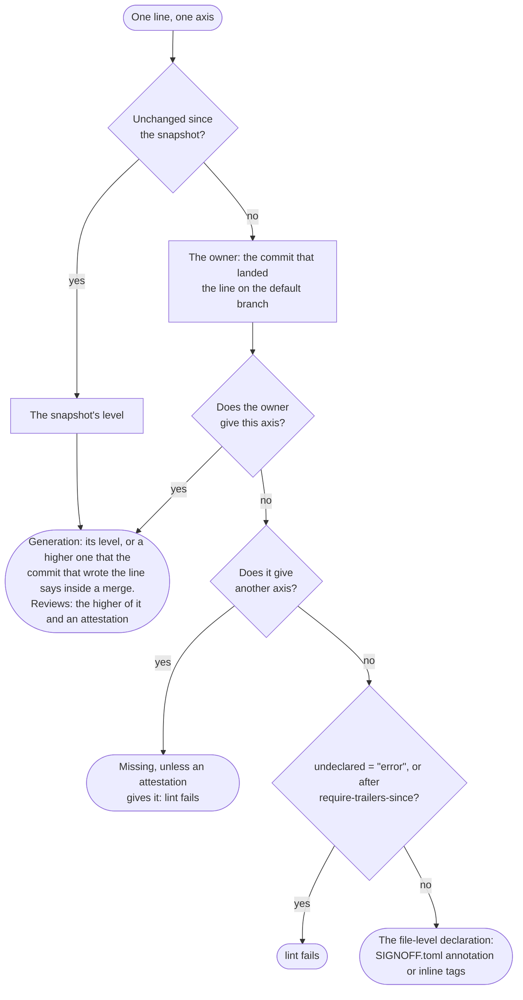
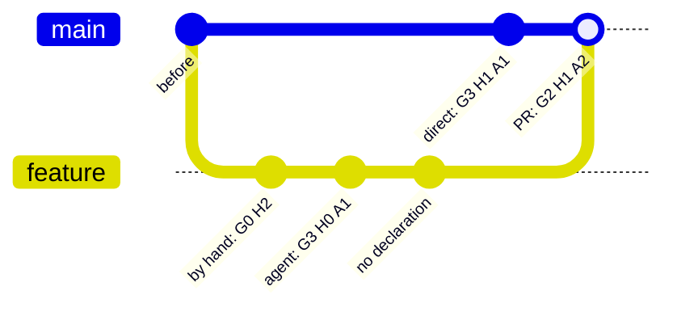

# Declaring lines

File-level declarations describe a file as a whole. With `[history]`, aisignoff declares **each line** from git instead: the commit that landed a line on the default branch declares it. For code developed through pull requests, that means each pull request declares exactly the lines it changed, with its description.

```toml
version = 3

[history]
enabled = true
```

Nothing else has to change at first. Lines whose commit declares nothing keep the [file-level declaration](files.md), so a repository without declared commits reports what it did before, and becomes more precise as declared pull requests land.

## One owner per line

Every line has **one owner**, and the owner declares it:

1. **Frozen.** A line unchanged since the [snapshot](snapshots.md) has the levels the snapshot recorded.
2. **Owner.** Otherwise its owner is the commit that landed it on the default branch, as `git blame --first-parent` finds it: a commit made there directly, a squash commit, or the merge commit of a pull request. The owner's message declares the levels, and a [`[[commits]]` entry](#correcting-a-commit) corrects them. Commits and pull requests *inside* a merge declare nothing, with one exception:
3. **Generation of a commit inside a merge.** The commit on the branch that wrote a line can say a *higher* `AI-Generation` for it, such as an agent's G3 commit in a pull request declared G1. Its message can't lower it; only a `[[commits]]` entry for that commit can (a hand-written commit in an AI-written pull request), because G0 takes the AI review requirement off a line.
4. **Reviews.** Each review is the higher of the owner's level and an [attestation](#raising-a-review-attestations) whose checked content had the line. On a tie, the attestation's names.
5. **Nothing declared.** An owner whose message declares nothing leaves its lines to the file-level declaration, unless [`undeclared = "error"`](#commits-that-declare-nothing) makes that a failure.

Why the landing commit? The lines that `git blame --first-parent` gives to a commit of the default branch are exactly the diff its pull request showed the reviewer, whether it landed as a merge or a squash, and in whatever order stacked pull requests were merged. The pull request description is the one statement made about exactly those lines.

For one line and one axis:



### An example

A pull request with three commits lands with a merge commit, while `main` moved on with a direct commit:



| Lines from | Get | Because |
|---|---|---|
| `before` | the file-level declaration | their owner declares nothing |
| `by hand: G0 H2` | G2 H1 A2 | the pull request's: a commit message can't lower the generation (a `[[commits]]` entry can) |
| `agent: G3 H0 A1` | G3 H1 A2 | the higher generation of the commit that wrote them; the reviews are the pull request's |
| `no declaration` | G2 H1 A2 | the pull request's |
| `direct: G3 H1 A1` | G3 H1 A1 | its own: it landed on `main` itself |

Generation follows the line and changes only when the line changes. Reviews can be raised for a whole file later. For a 200-line `solver.py`:

| Step | Result |
|---|---|
| A pull request adds it, declared G0 H2 A0 | 200 lines G0 H2 A0 |
| Another rewrites 100 lines, declared G2 H1 A1 | 100 lines G0 H2 A0, 100 lines G2 H1 A1 |
| `aisignoff attest solver.py -H H2 --reviewed-by "Jane Doe"` | 100 lines G0 H2 A0, 100 lines G2 **H2** A1 |
| A third changes 10 lines, declared G2 H1 A1 | those 10 lines are H1 again, the other 190 stay H2 |

## Declaring a commit

A commit message declares its lines with "Key: value" lines, using the keys of `SIGNOFF.toml`:

```
Add the folder report

AI-Generation: G3
Human-Review: H1
AI-Review: A1
Assisted-by: Claude Opus 5.5 (Anthropic)
Reviewed-by: Jane Doe
AI-Reviewed-by: Claude Opus 5.5 (Anthropic), self-check by the generating session
```

- **Anywhere in the body**, at the start of a line, not only in git's trailer block: a `Co-authored-by:` paragraph after them doesn't hide them. The subject line doesn't count.
- **Not in code.** Lines in fenced code blocks and HTML comments don't count, so a message can quote an example. A block or comment that is never closed isn't one, so a stray fence can't hide what follows.
- **An axis counts when its level is there.** A name on its own, such as a plain `Reviewed-by:` trailer, declares nothing. A level line left empty (`Human-Review:`) is `TODO`.
- **Conflicting levels** for one key in one message are an error.

A commit pushed to the default branch directly declares its own lines this way. A commit on a pull request's branch needs no declaration: only its `AI-Generation` is read ([rule 3](#one-owner-per-line)). A higher generation needs the model: without an `Assisted-by` of its own, the commit takes the one the pull request's declaration names, and the error names the commit when neither does.

## Pull request descriptions

A pull request declares its lines in its description, which lands in git as the message of its merge or squash commit. For that, set *Settings → General → Pull Requests* → the default message of merge commits (and of squash commits, if you allow them) to **Pull request title and description**. GitHub's default merge commit message holds only the title, and then the declaration never reaches git.

The description can use "Key: value" lines as above, or the checkboxes of a pull request template, such as the template of the Industrial Mathematics Group:

```markdown
- [x] **G3** AI-autonomous: an agent produced it largely end to end
- [x] **Claude Opus** (Anthropic)
- [ ] **Other:**
- [x] **H0** I checked the result as a whole
- [x] **H1** I ran the tests or reproduced the key results myself
- [x] **A1** The AI that wrote the change checked its own work
- [ ] **A2** A new AI session ... reviewed the final change. Model, if not one of the above:
```

| Axis | Level | Names |
|---|---|---|
| Generation | the ticked `**G…**` box; more than one is an error | the ticked models (`**Name** (Vendor)`) between the generation and the human review boxes, and the text after `**Other:**` |
| Human review | the highest ticked `**H…**` box | the commit's author. On GitHub, that is the pull request's author for a squash commit, but whoever clicked *Merge* for a merge commit: correct it with `[[commits]]` if that wasn't the reviewer |
| AI review | the highest ticked `**A…**` box, or **A0** when the AI review boxes are there and none is ticked | the text after `Model:` in that box, else the models that wrote the change |

Boxes in code blocks and HTML comments don't count, and other bold checklist items (`- [x] **Breaking change**`) aren't models. Generation or human review boxes that are there with none ticked are an unfilled template: `TODO`, which `lint` reports.

Use one form per message. A message with both "Key: value" lines and ticked level boxes is an error until a `[[commits]]` entry for that commit settles it; meanwhile both count, the lines winning where they overlap.

### Merge, squash or rebase

How a pull request lands decides which commit owns its lines:

| Lands as | Its lines are declared by |
|---|---|
| **Merge commit** | the merge commit, so the description. A commit of the branch can raise `AI-Generation` for the lines it wrote |
| **Squash** | the squash commit, so the description. The branch's commits are gone |
| **Rebase** | each commit on its own, without the description. A commit that declares nothing falls back to the file level |
| **Direct commit** | that commit |

Merge and squash give the same reviews. Tell aisignoff which one you use, so that checks before the merge show what will land:

```toml
[history]
merge-method = "merge"   # the default; or "squash", or "rebase"
```

With `squash`, the branch commits' generation is ignored, since the squash commit won't carry them. With `rebase`, the description is ignored and each commit must declare itself.

**Stacked pull requests.** When B is merged into A and A into the default branch, A's commit owns all the lines, B's included, and B's description is never read. `lint` warns when B's merge commit declares a higher `AI-Generation` than A's description does: declare the highest generation of everything that lands in A's description. When B is retargeted and lands on the default branch itself, it owns the lines its merge brings in.

## Commits that declare nothing

By default (`undeclared = "baseline"`), a landing commit whose message declares nothing leaves its lines to the file-level declaration, so a quick push stays quick. To require a declaration from every commit that lands lines on the default branch:

```toml
[history]
undeclared = "error"
```

`lint` then fails on lines whose owner declares nothing (a declaration can also come from a `[[commits]]` entry, or for reviews from an attestation). This catches a forgotten template or merge setting. Combine it with a [snapshot](snapshots.md), which keeps older, undeclared commits out of the check, or use `require-trailers-since = "<commit>"` to require it only for the commits after one commit of the default branch. Both need the whole history: in a shallow clone or outside git, `lint` fails rather than passing without the check.

Even with the default, `lint` warns (and `lint --strict` fails) where an undeclared owner is probably a mistake:

- **Commits that look like pull requests**, by a subject like "Merge pull request #12 …" or one ending in "(#12)", listed in one warning.
- **Reverts**: a commit whose message says "This reverts commit …" or "Reverts owner/repo#12", or whose subject starts with `Revert "`, and merges with one inside. A revert owns the lines it restores, so declare it with the levels of what it restores.
- **`git pull` merges** on the default branch, which own everything they brought in: a merge that declares nothing with declared commits inside it. Avoid them with `pull.rebase`, or declare the merge with `[[commits]]`.

## Partial declarations

An owner either declares nothing or declares all three axes. When it gives some axes but not all, the missing ones are an error ("declares levels, but no AI-Review"), not the file-level declaration, unless an attestation gives that review. An unfilled template (`TODO`) is an error too.

A `[[commits]]` entry corrects a commit axis by axis, so it can be partial when the commit's message declares the other axes. For a commit that declares nothing, the entry is the whole declaration and must give all three levels. To raise only a review of such lines, use an [attestation](#raising-a-review-attestations), which needs no declaration of the rest.

## Correcting a commit

The history of the default branch isn't rewritten, so a missing or wrong declaration is corrected in `SIGNOFF.toml`:

```toml
[[commits]]
commit = "6686c01"           # at least 4 hex digits
Human-Review = "H2"          # reviewed after the merge
Reviewed-by = "Jane Doe"
```

- An entry takes whole axes: at least one level, and a name only next to its level. It replaces those axes of the commit's message.
- It corrects the commit that **owns** the lines: for a pull request, its merge or squash commit. The same works for old commits without a declaration.
- For a commit inside a merged pull request, only `AI-Generation` counts, and it may be lower than the pull request's. `lint` warns about review levels there.
- An entry for a commit that isn't in the history of `HEAD` (rebased or squashed away) declares nothing, and `lint` says so.
- Entries don't change lines a [snapshot](snapshots.md) has frozen; `aisignoff freeze --reset FILE` applies them there.

## Raising a review: attestations

After reviewing whole files, attest them:

```bash
aisignoff attest src/solver.py -H H2 --reviewed-by "Jane Doe"
aisignoff attest src/ -a A2 --ai-reviewed-by "GPT-5 (OpenAI), fresh session"   # every declared file below src/
```

This appends one `[[attestations]]` entry per file, with the git blob hash of the content you checked:

```toml
[[attestations]]
path = "src/solver.py"
blob = "3f1c9e0d5b6a7c8e9f0a1b2c3d4e5f6a7b8c9d0e"
Human-Review = "H2"
Reviewed-by = "Jane Doe"
```

- **Reviews only.** An attestation gives `Human-Review`, `AI-Review` or both, never generation (correct generation with `[[commits]]`). `TODO` isn't allowed: it records a check that was done.
- **It covers the lines that content had.** Lines changed afterwards fall back to their own commit, so an attestation never covers code written after the review and can stay in the file. A review is the higher of the attestation's and the owner's.
- **It follows the content.** The blob survives a squash merge and a rename (`git mv`). The same content in another file, such as a copy, isn't covered.
- **It checks itself.** An attestation whose content never landed on the branch, or whose path was renamed away and created again, is reported by `lint`.
- **`--at REV`** attests the files as they were at an earlier commit, such as the commit a committed review covered. That also works for content from before a snapshot.
- Attestations count only with `[history]`, and not for files under `precedence = "override"`, which `attest` refuses.

## Lines that haven't landed yet

On a feature branch, in the merge preview that a pull request's CI run checks out, or with uncommitted changes, some lines aren't on the default branch yet. They are the diff against the newest commit of the default branch that `HEAD` contains, as GitHub shows a pull request.

- **Without a declaration for the change,** a line whose commit says an `AI-Generation` shows that generation, with its reviews undeclared until the pull request declares them; a line whose commit says nothing shows the file-level declaration. Nothing about them fails `lint`; `lint` and `report` say how many aren't fully declared yet. (With `merge-method = "rebase"`, the commits land as they are and are checked as such.)
- **With one,** they resolve as they will land. `--declare-from FILE` on `lint`, `report` and `diff` reads the pull request description exactly as the merge or squash commit's message will be read, and `lint` then requires it to be complete. That is the [check before the merge](ci.md#checking-the-pull-request-description).
- **A pull request into another branch** than the default one declares nothing: the pull request that lands its lines on the default branch does. `lint --base` and `diff` recognise it and say so.
- **`--landed`** says that `HEAD` is a commit of the default branch, or lands on it exactly as it is: a [merge queue's commit](ci.md#merge-queues) (recognised by itself on GitHub Actions) or a [release branch](ci.md#release-branches).

aisignoff finds the default branch as `origin`'s default branch, else the one GitHub Actions' event names, else `main` or `master`. Set `default-branch = "develop"` in `[history]` if it's called otherwise and you run CI elsewhere. When that branch is checked out, all of `HEAD` counts as landed; otherwise `origin/<name>` is used, or the local branch if it's ahead. With none found, every commit counts as landed; `lint --declare-from`, `--base` and `--landed` then fail, since there is nothing to check the change against. CI needs the whole history: check out with `fetch-depth: 0`. In a shallow clone, `lint` fails when `[history]` is enabled.

## Details

- **`TODO` is below every level.** A `TODO` review of an owner stays until a `[[commits]]` entry or an attestation fills it in.
- **A1 doesn't reach hand-written lines.** A1 means the generating session checked its own work. A line that a `[[commits]]` entry declares G0, in a pull request that ticks A1, takes A0, or the A2/A3 of an attestation. A declaration that says G0 and A1 itself is invalid.
- **Binary and empty files and symlinks** are one unit, counted as one line: the commit that last changed the file declares it.
- **Moved lines** belong to the commit that moved them: a line moved to another file is a new line there.
- **Whitespace-only changes** are ignored (`git blame -w`), so reindented lines keep their owner. In Python, indentation can change what code does; set `ignore-whitespace = false` to give reindented lines to the commit that reindented them.
- **Reformatting commits** would take over every line they touch. List them in `.git-blame-ignore-revs` (used automatically, or set `ignore-revs-file`). An entry that isn't a commit of the repository is reported. An ignored commit's lines go back to the commits before it, with their levels, so `lint` warns about an entry that declares levels, is a merge, or looks like a pull request.
- **Without history**, outside git or in a shallow clone, aisignoff warns and uses the file-level declarations; with `undeclared = "error"` or `require-trailers-since`, `lint` fails instead.
