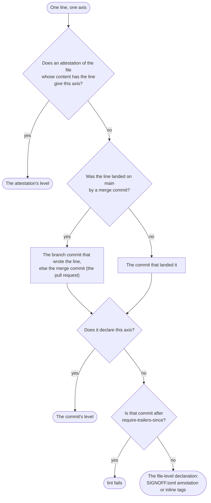
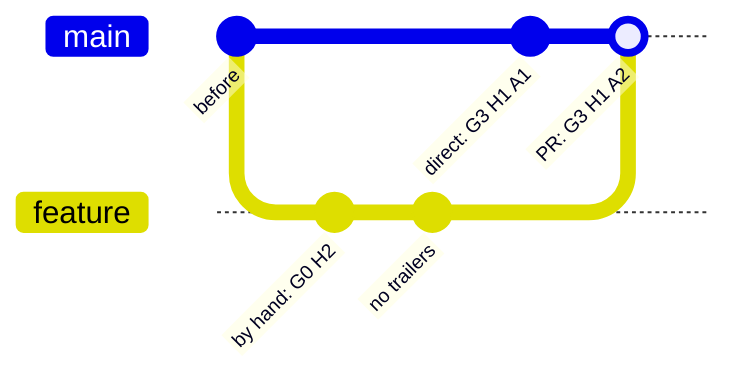

# Line by line

`SIGNOFF.toml` and inline tags declare whole files. With `[history]`, aisignoff declares **each line** instead, from git: a line takes the declaration of the commit that brought it in, so a pull request that changes 35 lines of a 800-line file changes the levels of those 35 lines, not of the whole file.

```toml
version = 3

[history]
enabled = true
```

Nothing else has to change. Lines without a declaration from git keep the file-level declaration, so a repository whose commits carry no trailers yet reports exactly what it did before; lines become more precise as declared commits land.

## Where a line's levels come from

For each axis, the newest of these wins:

1. **The commit that landed the line.** Its message carries the levels as [git trailers](#declaring-commits), or as the ticked checkboxes of a [pull request template](#pull-request-checkboxes). `git blame --first-parent` finds that commit on the current branch: for a pull request, the squash commit or the merge commit, so the pull request's declaration covers all its lines. For a merge commit, a commit of the merged branch that declares an axis itself overrides the merge on that axis, for the lines it wrote (see [Merge, squash or rebase](#merge-squash-or-rebase)).
2. **An attestation of the file** whose checked content already contained the line: "this whole file was reviewed, as it was then". See [Re-declaring a whole file](#re-declaring-a-whole-file).
3. **Otherwise, the file-level declaration**: the matching annotation in `SIGNOFF.toml`, or the file's inline tags.

As a flow, for one line and one axis:



An attestation comes first because the content it checked already had the line, so it is always at least as new as the line's commit. "The commit that landed the line" is what `git blame --first-parent` finds on `main`.

A commit declares an axis with a trailer or a ticked checkbox (one way per commit), and a `[[commits]]` entry corrects it. So the layers, from the bottom:

| Layer | Set by | Covers |
|---|---|---|
| File-level declaration | `[[annotations]]` in `SIGNOFF.toml`, inline tags | Lines that nothing below declares: the baseline |
| Commit declaration | Trailers or checkboxes of the commit that landed the line; for a merge, of the pull request, overridden per axis by the branch commit that wrote the line; corrected by `[[commits]]` | The lines that commit added or changed |
| Attestation | `aisignoff attest` (`[[attestations]]`) | Every line of the file as it was when attested, until the line changes again |

For example, a pull request with two commits, merged with a merge commit, while `main` moved on with a direct commit:



| Lines from | Get | Because |
|---|---|---|
| `before` | the file-level declaration | that commit declares nothing |
| `by hand: G0 H2` | G0 H2 A2 | generation and human review from the commit, AI review from the pull request |
| `no trailers` | G3 H1 A2 | everything from the pull request |
| `direct: G3 H1 A1` | G3 H1 A1 | its own trailers; it isn't part of the pull request |

The axes stay separate. Generation follows the line: it only changes when the line changes. A review (human or AI) can be raised for a whole file by an attestation, without touching generation.

For example, a 200-line `solver.py`:

| Step | Result |
|---|---|
| A pull request adds the file, declared G0 H2 A0 | 200 lines G0 H2 A0 |
| Another one rewrites 100 lines, declared G2 H1 A1 | 100 lines G0 H2 A0, 100 lines G2 H1 A1 |
| `aisignoff attest solver.py -H H2 --reviewed-by "Jane Doe"` | 100 lines G0 H2 A0, 100 lines G2 **H2** A1 |
| A third one changes 10 lines, declared G2 H1 A1 | those 10 lines are back to H1, the other 190 stay H2 |

## Declaring commits

A commit declares its lines with trailers, the last paragraph of its message, using the same keys as `SIGNOFF.toml`:

```
Add the folder report

AI-Generation: G3
Human-Review: H1
AI-Review: A1
Assisted-by: Claude Opus 5.5 (Anthropic)
Reviewed-by: Jane Doe
AI-Reviewed-by: Claude Opus 5.5 (Anthropic), self-check by the generating session
```

- **An axis counts when its level is there.** A name on its own, such as the common `Reviewed-by:` trailer without `Human-Review:`, declares nothing.
- **Pull requests:** set *Settings → General → Pull Requests* → the default commit message of merge commits (and of squash commits, if you allow them) to **Pull request title and description**, and put the trailer lines at the end of the pull request description, as its last paragraph. The declaration then lands in git with the code. GitHub's default message for merge commits holds only the title, so without this setting the declaration never reaches git.
- **TODO** works as in `SIGNOFF.toml`: `lint` reports it until it's filled in.

### Pull request checkboxes

A pull request template can declare the levels with checkboxes instead, as the template of the Industrial Mathematics Group does. With the squash commit message *Pull request title and description*, the ticked boxes land in the commit message, and aisignoff reads them like trailers. A commit declares itself one way or the other: one with both trailers and ticked level boxes is reported by `lint`.

```markdown
- [x] **G3** AI-autonomous: an agent produced it largely end to end
- [x] **Claude Opus** (Anthropic)
- [ ] **Other:** 
- [x] **H0** I checked the result as a whole
- [x] **H1** I ran the tests or reproduced the key results myself
- [x] **A1** The AI that wrote the change checked its own work
- [ ] **A2** A new AI session ... reviewed the final change. Model, if not one of the above: 
```

| Axis | Level | Names |
|---|---|---|
| Generation | the ticked `**G…**` box (more than one is a problem) | the ticked models (`**Name** (Vendor)`), and the text after `**Other:**` |
| Human review | the highest ticked `**H…**` box | the commit author (on GitHub, the pull request's author) |
| AI review | the highest ticked `**A…**` box | the text after `Model:` in that box, or else the models that wrote the change |

So each pull request declares its own lines, and `SIGNOFF.toml` doesn't grow with every pull request: it keeps the defaults for lines without a declaration, `[[commits]]` corrections and attestations.

### Merge, squash or rebase

`git blame --first-parent` follows only the first parents of the default branch, so every line a pull request brought in belongs to the commit that landed it there, and lines that were on the branch before the pull request started never do. How a pull request lands decides what declares its lines:

| Pull request lands as | Its lines are declared by |
|---|---|
| **Merge commit** (recommended) | The merge commit (the pull request description) for every line the branch adds. A commit of the branch that declares an axis itself (trailers in its message) overrides the merge on that axis, for the lines it wrote: the pull request is the default, a commit the exception, e.g. a hand-written G0 commit in an AI-written pull request |
| **Squash** | The squash commit alone (the pull request description). The commits of the branch are gone, and so are their own declarations |
| **Rebase** | Each commit on its own: they land on the default branch one by one, without the pull request description. A commit without a declaration falls back to `SIGNOFF.toml` (or fails `require-trailers-since`) |
| **Commit on the default branch** | That commit |

Commits that merge the default branch into the pull request's branch, and conflict resolutions, declare nothing themselves, so their lines take the pull request's declaration.

Because this works axis by axis, a commit only needs to declare what is known when it's written. For example, a hand-written commit declares

```
AI-Generation: G0
Human-Review: H2
Reviewed-by: Jane Doe
```

and nothing on AI review. If the pull request is then reviewed as a whole by a fresh AI session and declares A2 (and G3 H1 for the rest), the lines of that commit end up G0 H2 A2, and the other lines of the pull request G3 H1 A2.

### Correcting a commit

The history of the default branch isn't rewritten, so a missing or wrong trailer is corrected in `SIGNOFF.toml`, per axis:

```toml
[[commits]]
commit = "6686c01"           # at least 4 hex digits
Human-Review = "H2"          # reviewed after the merge
Reviewed-by = "Jane Doe"
```

The same works for old commits without trailers ("backfilling").

## Re-declaring a whole file

After reviewing a whole file, attest it:

```bash
aisignoff attest src/solver.py -H H2 --reviewed-by "Jane Doe"
aisignoff attest src/ -a A2 --ai-reviewed-by "GPT-5 (OpenAI), fresh session"   # every file below src/
```

This appends one entry per file to `SIGNOFF.toml`, with the git blob hash of the content you checked:

```toml
[[attestations]]
path = "src/solver.py"
blob = "3f1c9e0d5b6a7c8e9f0a1b2c3d4e5f6a7b8c9d0e"
Human-Review = "H2"
Reviewed-by = "Jane Doe"
```

- **It covers the lines that content had.** Lines changed afterwards fall back to the declaration of their own commit. So an attestation never covers code written after the review, and can stay in the file.
- **Content, not commits.** The blob survives a squash merge, unlike a commit hash, and a rename: the attestation follows the file to its new name (`git mv`, detected by git). Commit the attestation in the same pull request as the review, or later.
- **That file only.** The same content in another file, such as a copy, doesn't extend the attestation.
- **It checks itself.** If the file changes again before the attested content reaches the branch, `lint` reports that the attestation points at content that never landed: attest again.
- **`--at REV`** attests the files as they were at an earlier commit, e.g. the commit a committed review covered.
- **Generation** can be attested too (`-g`), for corrections; normally an attestation only raises the review axes.

## Requiring declared commits

```toml
[history]
enabled = true
require-trailers-since = "a1b2c3d"
```

Lines of commits after `a1b2c3d` must be declared by their commit (trailers, checkboxes, `[[commits]]` or an attestation); `lint` fails instead of falling back to the file-level declaration. This catches a forgotten pull request template or squash setting. The merge preview that a pull request's CI run checks out is exempt, since the pull request isn't merged yet.

This check needs the whole history: in a shallow clone or outside git, `lint` fails, rather than passing without it.

## Showing a change: `aisignoff diff`

```bash
aisignoff diff origin/main
```

```
Changes since origin/main (6686c01): +412 −38 lines in 9 file(s)

       +lines  -lines  Generation (added)  Human review (added)  AI review (added)
docs/     +95     -12  G3 +95              H1 +95                A1 +95
src/     +317     -26  G3 +317             H1 +317               A1 +317

Attested:
  src/aisignoff/model.py  H2

Whole repository, by lines:
  Human review: H1 69.0% → 66.6% (-2.4) · H2 31.0% → 33.4% (+2.4)
```

Like a coverage diff, it shows only what changed: the levels of the added lines (now), of the removed lines (at the base, in `--json`), the attestations the change adds, and how the shares of the whole repository move. It compares the working tree, so it also works before committing. The base is the merge base of `BASE` and `HEAD`, as in a pull request on GitHub: when `main` has moved on since a branch started, its new commits aren't part of the branch's change.

| Option | Effect |
|---|---|
| `--depth N` | Group by folders down to depth `N` (default 1) |
| `--files` | One row per file |
| `--markdown` | A Markdown table, e.g. for the job summary of a pull request |
| `--json` | Everything, including the levels of the removed lines |
| `-g`, `-H`, `-a` and the name options | Declare the change: lines after the base without a declaration of their own take these levels (not in files with `precedence = "override"`) |

For the same change in the [folder report](report.md), with each changed line in its file: `aisignoff report --html report.html --with-source --since origin/main`.

The last row is for pull requests: before the merge, their lines have no squash commit yet, so a workflow can pass the levels from the pull request description. [`signoff-pr-diff.yml`](integration.md) does that.

## Where history isn't available

- **Outside a git repository** and in **shallow clones** (the default of `actions/checkout`), aisignoff warns and uses the file-level declarations; with `require-trailers-since`, `lint` fails. In CI, check out with `fetch-depth: 0`.
- **Binary and empty files and symlinks** are one unit, counted as one line: the whole file takes the declaration of the commit that last changed it.
- **`precedence = "override"`** on an annotation keeps its files file level, e.g. for vendored or generated code.
- **Reformatting commits** would take over every line they touch. List them in `.git-blame-ignore-revs` (used automatically, or set `ignore-revs-file` in `[history]`); whitespace-only changes are ignored anyway. An entry that isn't a commit of the repository is reported by `lint`.
