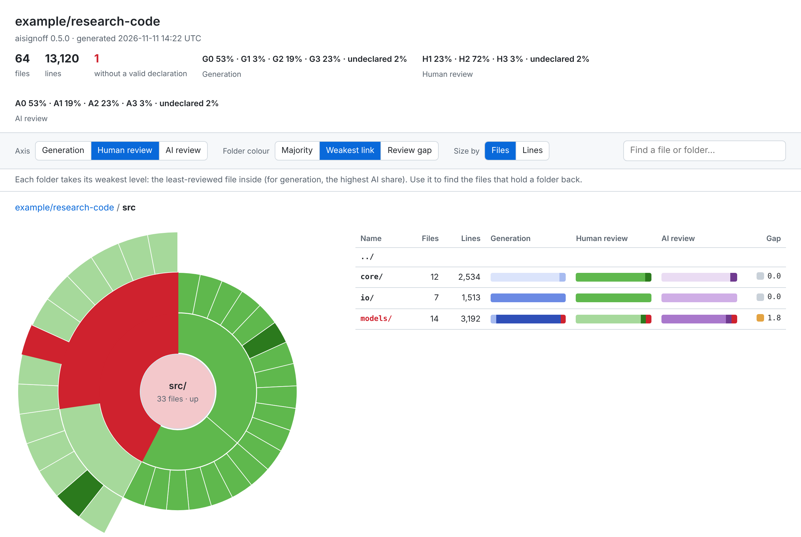

# Folder report

The badges give one number per axis for the whole repository. The folder report shows where those numbers come from: the level mix of every folder, down to each file.



## In the terminal

```bash
aisignoff report --tree
```

```
                       files  Generation      Human review  AI review
.                         30  G0 3% · G3 97%  H1 100%       A1 93% · A2 7%
├─ .github/workflows/      6  G3 100%         H1 100%       A1 100%
├─ docs/                   9  G3 100%         H1 100%       A1 100%
├─ src/aisignoff/          8  G3 100%         H1 100%       A1 88% · A2 12%
└─ tests/                  1  G3 100%         H1 100%       A1 100%
```

Folders that hold nothing but one subfolder are shown as one row (`.github/workflows/`). Files without a valid declaration are always listed under their folder, with the reason; `--files` lists every file.

| Option | Effect |
|---|---|
| `--depth N` | Folders down to depth `N` only (`0`: just the total) |
| `--weight lines` | Shares by lines instead of files |
| `--files` | Every file, not only the ones with problems |
| `--markdown` | A Markdown table, e.g. for the job summary of a CI run |
| `--json` | The whole tree with the counts of each folder, for other tools |

## The interactive report

```bash
aisignoff report --html aisignoff-report.html
```

writes a single HTML file. It needs no server and no internet connection, so it can be opened locally, attached to a release or downloaded from a CI run.

| Option | Effect |
|---|---|
| `--title TITLE` | The title of the page (default: the repository or folder name) |
| `--with-source` | Embeds the text of each file (up to 512 KB each, not binary files), for the line view |
| `--since BASE` | Marks what changed since commit `BASE` (its merge base with `HEAD`), e.g. `origin/main` in a pull request or the last release tag |

`--with-source` puts the code into the report: share the file only with people who may read the repository. Symlinks are never followed: the report shows that a file is a symlink, not what it points to.

- **Sunburst.** Each ring is one folder level, and each arc is as large as its files (or lines). Click a folder to zoom in, the centre to go back up. Hover for the mix of a folder.
- **Folder table.** The folders and files of the current folder, with a bar per axis. Click a column to sort, for example by *Human review* to find the least-reviewed folder first.
- **File details.** Click a file for its levels, the names behind them, where the declaration comes from (`SIGNOFF.toml [4]` is the fourth annotation, `inline` a tag in the file) and any problems. On GitHub Actions the file name links to the file at that commit (as committed: changes in the working tree aren't on GitHub).
- **Lines.** The file details end with a strip of the whole file, coloured by the level of each line: with [`[history]`](history.md), files mix levels line by line. With `--with-source`, the text of the file follows, each line with its level in the margin; hover the margin for where the declaration comes from, click a line number to open it on GitHub.
- **Changes.** With `--since BASE`, the report also knows what changed since `BASE`: a *Changed* column, a switch to show only the changed files and folders (the rest fade in the sunburst), and in the file details the changed lines, marked `+`, with three lines around them.
- **Find.** Type part of a path to jump to a file or folder.
- **Links.** The address keeps the folder, axis, colouring, selected file and line, so a link opens the same view.

With [`[history]`](history.md), a file can mix levels like a folder: the table shows bars for it, and its details list the lines behind each level (with links to them on GitHub Actions). Shares by *files* then count each file once, split by its lines.

Files excluded in `SIGNOFF.toml` (`exclude = [...]`) never appear, as in `lint`. Without a valid declaration, a file counts as *undeclared* on all three axes and is shown in red.

### Folder colour

A file has one level per axis, but a folder holds a mix. Three ways to colour folders, chosen at the top of the report:

| Colour | A folder shows | Good for |
|---|---|---|
| **Majority** (default) | The level that covers most of its files or lines; a red outline when any file inside is undeclared | The overall picture |
| **Weakest link** | Its weakest level: the least-reviewed file inside, or for generation the highest AI share | Finding the files that hold a folder back |
| **Review gap** | The average gap of its files, from grey (0) to brown (3) | Finding AI-written code that had little human review |

The review gap of a file is its generation level minus its human review level, never below 0: G3 tested at H1 has a gap of 2, G0 or G3 reviewed at H3 have none. The axis buttons are off in this mode, because the gap combines two axes.

## Publishing the report

| Where | How |
|---|---|
| CI run | `signoff-lint.yml` and `signoff-badges.yml` in the [example workflows](integration.md) upload `aisignoff-report.html` as an artifact of each run, and write `report --tree --markdown` to the job summary |
| Release | `signoff-release.yml` attaches the report to each release |
| GitHub Pages | `signoff-pages.yml` publishes it on every push to `main`. Opt-in, because a repository has a single Pages site |
| A documentation site | Write it into the built site, as below |

With a documentation site on Pages, add the report to the site instead of replacing it. After the build step:

```bash
aisignoff report --html site/signoff/index.html
```

The report is then at `https://<owner>.github.io/<repo>/signoff/`. This documentation does the same: [the folder report of aisignoff](https://industrial-mathematics-group.github.io/aisignoff/signoff/).
